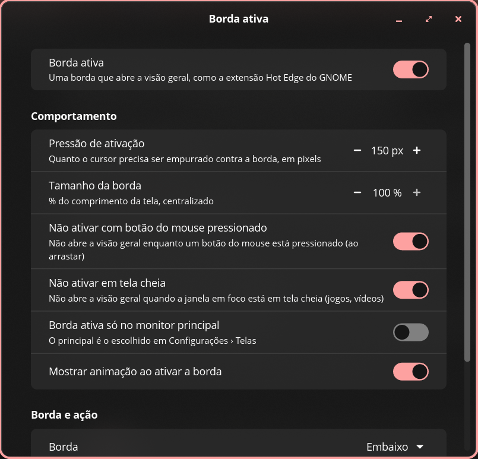

# Borda ativa (Hot Edge) para o COSMIC

A extensão [Hot Edge](https://extensions.gnome.org/extension/4222/hot-edge/) do GNOME no
COSMIC: empurre o cursor contra a borda de baixo da tela e a visão geral (os espaços de
trabalho) abre; empurre de novo e ela fecha. É como uma dock que se esconde, sem mudar
nada no desktop. Vem com um app para configurar, com as mesmas opções da extensão.



## O que dá para configurar

As opções da extensão, com os mesmos padrões:

| Opção | Padrão | |
| --- | --- | --- |
| Pressão de ativação | 150 px | quanto o cursor precisa ser empurrado contra a borda |
| Tempo de ativação | 250 ms | só onde não dá para medir a pressão, e ao arrastar algo até a borda |
| Tamanho da borda | 100% | a parte ativa, centralizada; menos deixa os cantos de fora |
| Não ativar com botão do mouse pressionado | sim | |
| Não ativar em tela cheia | sim | jogos, vídeos |
| Borda ativa só no monitor principal | não | o principal é o de Configurações › Telas |
| Mostrar animação ao ativar | sim | as ondas do GNOME |

E, como o COSMIC não tem uma visão geral única, duas a mais:

| Opção | Padrão | |
| --- | --- | --- |
| Borda | Embaixo | ou em cima, à esquerda, à direita |
| Abrir | Visão geral | ou a biblioteca de apps, o iniciador, ou qualquer comando |

Como na extensão, uma tela não ganha borda onde houver outro monitor depois dela (para o
cursor poder passar de um para o outro).

## Instalar

Há pacotes prontos nas [releases](https://github.com/DrakRosmann/cosmic-ext-hot-edge/releases),
para x86_64 e aarch64, que funcionam em qualquer distribuição com o COSMIC:

| | |
| --- | --- |
| Debian, Ubuntu, Pop!_OS, Mint… | `sudo apt install ./cosmic-ext-hot-edge_*_amd64.deb` |
| Fedora, openSUSE… | `sudo dnf install ./cosmic-ext-hot-edge-*.x86_64.rpm` |
| Arch, Manjaro, EndeavourOS, CachyOS… | `sudo pacman -U cosmic-ext-hot-edge-*-x86_64.pkg.tar.zst` |
| Qualquer outra | baixe o `.tar.gz`, extraia e rode `./install.sh` (em `~/.local`) |

Depois abra **Borda ativa** na biblioteca de apps: ele já liga a borda, sem precisar sair
da sessão. Nas próximas vezes ela começa sozinha com a sessão.

No Arch dá também para compilar com o `PKGBUILD` de `packaging/arch/` (`makepkg -si`).

### Compilar

```sh
./install.sh            # em ~/.local, só para você
sudo ./install.sh /usr  # para todos
```

O `deps.sh` instala o que falta para compilar (com `apt`, `dnf`, `pacman` ou `zypper`).
O libcosmic pede o Rust 1.93 ou mais novo; se o da distribuição for mais antigo (Debian,
Ubuntu e Pop!_OS LTS), instale-o pelo [rustup](https://rustup.rs), ou use um pacote pronto.

Para remover: `./uninstall.sh` (ou `sudo ./uninstall.sh /usr`), ou pelo gerenciador de pacotes.

## Como funciona

São dois programas:

- **`cosmic-ext-hot-edge-daemon`** começa com a sessão (`/etc/xdg/autostart` ou
  `~/.config/autostart`) e põe em cada tela uma faixa transparente de 1 pixel na borda, acima
  de tudo (uma superfície *layer-shell*). O cursor não passa da borda, mas o compositor
  continua informando quanto ele foi movido (`zwp_relative_pointer_v1`): é a mesma
  "pressão" das barreiras do GNOME, contada do mesmo jeito (`PressureBarrier`: no máximo
  15 px por movimento, só o que entra na borda, dentro de 1 segundo). Passando do limite, ele
  roda o mesmo comando dos atalhos do COSMIC (`cosmic-workspaces` para a visão geral, como o
  Super+W), que abre ou fecha. Usa só 1,6 MB e não depende de nada além da libc.
- **`cosmic-ext-hot-edge`** é o app de configurações (libcosmic). Ele grava em
  `~/.config/cosmic/io.github.DrakRosmann.CosmicHotEdge/v1/`, e o daemon aplica na hora.

Tela cheia: o daemon acompanha as janelas (`zcosmic_toplevel_info_v1`) e não ativa se a
janela em foco naquela tela está em tela cheia. Monitor principal: o que o COSMIC marca como
principal (`cosmic-randr list`).

Para ver o que a borda percebe: `HOT_EDGE_DEBUG=1 cosmic-ext-hot-edge-daemon`.

### Diferenças para o GNOME

- A faixa de 1 pixel fica por cima do que estiver na borda: um clique bem no último pixel
  vai para ela. Com a dock do COSMIC embaixo e escondida, empurrar até o fim da tela abre
  a visão geral em vez de mostrar a dock (que continua aparecendo nos pixels logo acima);
  se preferir a dock, use a borda de outro lado ou diminua o tamanho da borda.
- O COSMIC tem o próprio canto ativo (Configurações › Área de trabalho › Espaços de
  trabalho); os dois funcionam juntos.

## In English

GNOME's [Hot Edge](https://extensions.gnome.org/extension/4222/hot-edge/) extension for
COSMIC: push the pointer into the bottom edge of the screen to open the workspaces overview,
push again to close it, like an auto-hiding dock without changing the desktop. A settings
app has the extension's preferences with the same defaults (activation pressure 150 px,
fallback timeout 250 ms, edge size, suppress while a mouse button is held or a fullscreen
window is focused, primary monitor only, ripple animation), plus which edge and what it opens
(overview, app library, launcher or any command).

A small daemon, started with the session through XDG autostart, puts a transparent 1 px
layer-shell strip on each screen's edge. The pointer can't go past the edge, but the
compositor still reports relative motion (`zwp_relative_pointer_v1`), which is summed the
way GNOME's `PressureBarrier` does; past the threshold it runs the same command as COSMIC's
shortcut (`cosmic-workspaces`, which toggles). Fullscreen comes from
`zcosmic_toplevel_info_v1`, the primary monitor from `cosmic-randr`.

Install a package from the [releases](https://github.com/DrakRosmann/cosmic-ext-hot-edge/releases)
(`.deb` for Debian, Ubuntu and Pop!_OS, `.rpm` for Fedora and openSUSE, `.pkg.tar.zst` for
Arch, or the tarball's `install.sh` anywhere; x86_64 and aarch64, built against Debian 12's
glibc so they run on all of them), then open **Hot Edge** from the app library. Or build it:
`./install.sh` (needs Rust 1.93+; `deps.sh` installs the rest with apt, dnf, pacman or zypper).

## Licença

GPL-3.0-only. Baseado no comportamento da extensão
[Hot Edge](https://github.com/jdoda/hotedge) de Jonathan Doda (GPL-2.0-or-later).
